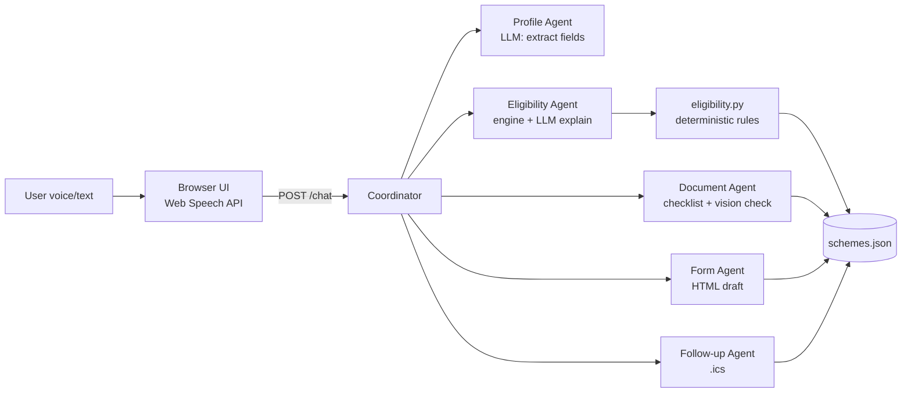

# Architecture



## Components
| File | Role |
|---|---|
| `main.py` | FastAPI app, routes, static serving |
| `agents.py` | Profile, Eligibility, Document, Form, Follow-up agents |
| `coordinator.py` | Session state machine, picks next agent, builds trace |
| `eligibility.py` | Pure-Python rule engine (no LLM) |
| `llm.py` | Provider wrapper (Gemini via google-genai, Groq via groq SDK): text, JSON and image calls, retries, timeouts, automatic fallback |
| `data/schemes.json` | Verified scheme facts |
| `static/index.html` | UI: mic, chat, trace panel, upload, downloads |
| `tests/` | Eligibility + API tests |

## State machine (per session)
`COLLECT_PROFILE → MATCH → DOCUMENTS → FORM → REMINDERS → DONE`
- Stay in `COLLECT_PROFILE` while required fields are missing (one question per turn).
- After `MATCH`, the user picks a scheme (or all) to continue to `DOCUMENTS`.
- The user can say "start over" at any time.

## Session object
```json
{
  "session_id": "uuid",
  "lang": "hi",
  "state": "COLLECT_PROFILE",
  "profile": {},
  "missing": [],
  "matches": [],
  "selected_scheme": null,
  "history": []
}
```
Sessions are kept in memory (a dict). No database.

## API
| Method | Path | Purpose |
|---|---|---|
| GET | `/health` | liveness |
| POST | `/chat` | `{session_id, message, lang}` → `{reply, lang, state, matches, trace}` |
| POST | `/upload-doc` | multipart image + `session_id` → `{doc_type, matches_checklist, notes}` |
| GET | `/form/{scheme_id}?session_id=` | printable HTML draft |
| GET | `/reminders.ics?session_id=&scheme_id=` | calendar file |
| POST | `/demo/load` | loads a sample farmer profile |

## Trace format
```json
{"agent": "eligibility", "action": "matched 2 schemes", "ms": 412}
```
Shown live in the UI side panel.

## Error handling
- LLM error/timeout: retry once, then show a friendly message and offer text input.
- Unknown language: ask "हिंदी या English?"
- Unsupported speech API: hide the mic, show the text box.
